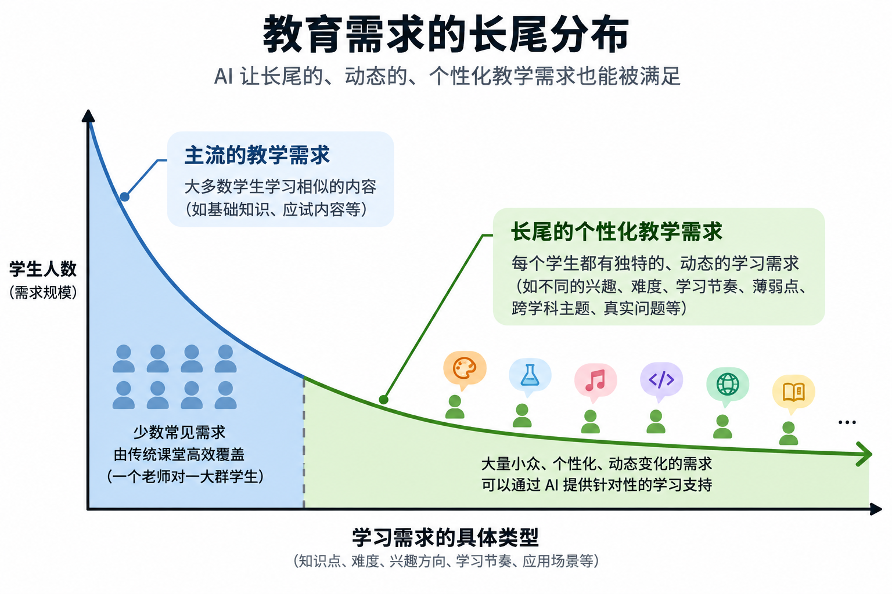

# Long-Tail Education · 教育长尾达成计划

[English](README_EN.md) | **简体中文**

*上图以网络延迟展示长尾形态，仅作概念参考，并非教育需求的统计数据。*

收集各种传统课堂难以满足，而 AI 有可能满足的个性化学习需求与方案。

> ## 🌟 带来一个问题、一种尝试，或一个值得一起完成的项目，一起出发！

## 一、核心概念

**教师的时间有限，学习者的需求却各不相同。** 统一内容、统一进度的课堂能够覆盖许多共性需求，却难以持续照顾每个人的知识缺口、兴趣、节奏和即时困惑。

AI 有望降低个性化教学支持的成本，让这些分散、动态的“长尾需求”得到更多回应。我们希望探索：当教学支持更容易获得时，教育如何变得更加因人而异？教师也能因此腾出时间，投入引导、关怀与更复杂的教学判断。

## 二、长尾需求

### 2.1 传统教育暴露的需求

学习者的差异会产生多种个性化需求，我们可以从以下维度理解和收集：

| 维度 | 示例 |
| --- | --- |
| 知识差异 | 某个知识点没听懂 |
| 学习速度 | 有人需要讲 3 次，有人一次就懂 |
| 表达方式 | 图像 / 比喻 / 数学 / 故事 |
| 兴趣 | 足球、游戏、历史、天文 |
| 难度 | 补基础 / 正常 / 拔高 |
| 学习路径 | 不同前置知识导致不同路线 |
| 实际应用 | “函数到底有什么用？” |
| 跨学科 | 用物理学数学，用历史学英语 |
| 实时问题 | 突然对某个问题产生兴趣 |
| 情境需求 | 考试前、做项目、阅读论文 |
| 反馈需求 | 为什么这一步错 |
| 元认知 | 我到底哪里不会？ |

长尾不等于少数学生的需求；每个人都可能在不同阶段遇到自己的长尾问题。

### 2.2 “做中学”需求

学习也可以从“我想做什么”出发：制作一个小游戏、设计校园节水方案，或研究纸飞机为什么飞得远。

AI 可以帮助将有趣的项目拆解为项目式学习（PBL）任务：**明确问题 → 拆解任务 → 按需学习 → 动手验证 → 反馈迭代**。让知识在解决问题时被理解和运用，减少对单向灌输的依赖。

我们欢迎分享适合不同兴趣、基础和条件的项目，以及其中的知识点、引导方式和实践经验。

## 三、这里想做的

这是一个开放的共创 Hub，连接学习者、教师、家长、研究者和开发者。从真实学习场景出发，汇集需求、想法、教学实验、解决方案和工具原型，共同探索哪些方法有效、适用于谁、还有什么不足。

我们准备以 **Long Tail Learning Catalog（长尾学习目录）** 持续整理贡献：

| 目录 | 收录内容 |
| --- | --- |
| `papers/` | 跟教育长尾达成计划相关论文 |
| `cases/` | 真实学习需求、困惑与课堂难以覆盖的场景 |
| `projects/` | “做中学”项目及 PBL 任务拆解 |
| `experiments/` | 教学实验、学习反馈与效果观察 |
| `solutions/` | 教学策略、资源、提示词与可复用方案 |
| `research/` | 相关研究、证据与讨论 |
| `prototypes/` | 软件原型与代码 |

**欢迎通过 Discussions 交流想法，通过 Issues 提交需求或实验，通过 Pull Requests 补充目录。** 产品功能建议同样欢迎，也请尽量说明它希望解决的真实问题。

提交案例时，简单写清楚：**谁在学、想学或想做什么、卡在哪里、希望怎样得到帮助**；已有尝试的，可以补充方法、结果和不足。请使用匿名案例，避免上传可识别的学生个人信息。

## 四、开放性 Roadmap

项目不预设唯一产品，也不要求所有方向按固定顺序推进。我们希望和参与者一起：

- 积累真实需求与有趣项目，逐步形成可检索、可复用的 Catalog。
- 探索学习需求分类，以及需求、教学策略和资源之间的关联。
- 开展小规模教学实验，记录有效经验，也保留失败与未知。
- 围绕有价值的场景孵化工具、软件应用或其他实践方案。

这些方向可以并行、调整，也欢迎新的分支。下一步做什么，由真实需求、实验反馈与社区贡献共同决定。

**本项目汇集的 idea、方案、实验、代码和可公开的数据都将开放共享；文档与数据采用明确的开放许可，代码采用开源许可。** 贡献者请确保拥有相应授权；涉及隐私的数据应先匿名化再提交。
