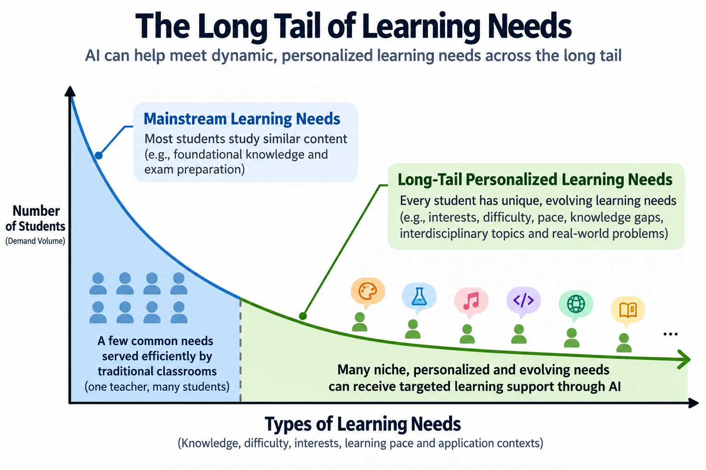

# Long-Tail Education

**English** | [简体中文](README.md)

*The image above uses network latency to illustrate the shape of a long-tail distribution. It is provided only as a conceptual reference and does not represent statistical data about educational needs.*

This project collects personalized learning needs that conventional classrooms struggle to meet, along with ideas and solutions through which AI may help address them.

> ## 🌟 Bring a question, an experiment, or a project worth building together—let's get started!

## 1. Core Idea

**Teachers have limited time, while every learner has different needs.** A classroom built around the same content and pace can address many common needs, but it cannot continuously accommodate every learner's knowledge gaps, interests, learning speed, and questions as they arise.

AI may reduce the cost of personalized learning support and make it possible to respond to more of these diverse and evolving “long-tail needs.” We want to explore a question: when educational support becomes easier to access, how can learning become more responsive to each individual? This could also give teachers more time for guidance, care, and complex educational decisions.

## 2. Long-Tail Needs

### 2.1 Needs Revealed by Conventional Education

Differences among learners create many kinds of personalized needs. We can understand and collect them across the following dimensions:

| Dimension | Example |
| --- | --- |
| Knowledge gaps | A learner did not understand a particular concept |
| Learning pace | One learner needs three explanations, while another understands immediately |
| Mode of explanation | Visuals / analogies / mathematics / stories |
| Interests | Football, games, history, astronomy |
| Difficulty | Foundational support / standard level / advanced challenges |
| Learning path | Different prior knowledge calls for different routes |
| Practical application | “What are functions actually useful for?” |
| Interdisciplinary learning | Learning mathematics through physics or English through history |
| Questions in the moment | A learner suddenly becomes curious about a topic |
| Situational needs | Preparing for an exam, building a project, or reading a paper |
| Feedback | Why is this step wrong? |
| Metacognition | What exactly am I struggling to understand? |

Long-tail needs are not limited to a small group of students. Everyone may encounter their own long-tail questions at different stages of learning.

### 2.2 Learning by Doing

Learning can also begin with a goal: building a small game, designing a water-saving plan for a school, or investigating why some paper airplanes fly farther than others.

AI can help turn engaging projects into project-based learning (PBL) activities: **define the problem → break it into tasks → learn on demand → build and test → reflect and iterate**. This allows learners to understand and apply knowledge while solving real problems, reducing their dependence on one-way instruction.

We welcome projects suited to different interests, backgrounds, and circumstances, together with their relevant concepts, approaches to guidance, and practical lessons.

## 3. What We Want to Build Here

This is an open, collaborative hub connecting learners, teachers, parents, researchers, and developers. Starting from real learning situations, we aim to gather needs, ideas, teaching experiments, solutions, and tool prototypes. Together, we can explore what works, whom it works for, and where it still falls short.

We plan to organize contributions as a growing **Long Tail Learning Catalog**:

| Directory | Contents |
| --- | --- |
| `papers/` | Papers related to the Long-Tail Education initiative |
| `cases/` | Real learning needs, difficulties, and situations that classrooms struggle to cover |
| `projects/` | Learning-by-doing projects and breakdowns of PBL activities |
| `experiments/` | Teaching experiments, learner feedback, and observations of outcomes |
| `solutions/` | Teaching strategies, resources, prompts, and reusable approaches |
| `research/` | Related research, evidence, and discussion |
| `prototypes/` | Software prototypes and code |

**Use Discussions to exchange ideas, Issues to submit needs or experiments, and Pull Requests to expand the catalog.** Product feature suggestions are also welcome; whenever possible, please explain the real problem that the proposed feature is intended to solve.

When submitting a case, briefly describe: **who is learning, what they want to learn or create, where they are getting stuck, and what kind of help they hope to receive**. If something has already been tried, you can also include the approach, outcome, and limitations. Please use anonymized cases and do not upload personally identifiable student information.

## 4. An Open Roadmap

This project does not assume a single product or require every direction to follow a fixed sequence. Together with contributors, we hope to:

- Gather real needs and engaging projects, gradually building a searchable and reusable catalog.
- Explore ways to classify learning needs and connect them with teaching strategies and resources.
- Run small-scale teaching experiments, documenting effective practices while preserving failures and open questions.
- Incubate tools, software applications, and other practical solutions around valuable learning scenarios.

These directions can progress in parallel, change over time, and grow into new branches. What comes next will be shaped by real needs, experimental feedback, and community contributions.

**The ideas, solutions, experiments, code, and publishable data collected by this project will be openly shared. Documentation and data will use clearly stated open licenses, while code will use an open-source license.** Contributors should ensure that they have the necessary rights to share their work. Any data involving privacy must be anonymized before submission.
