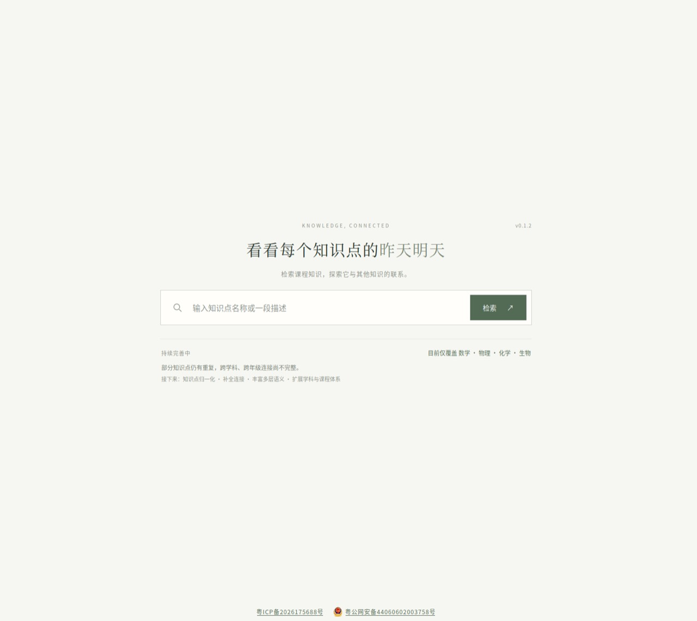
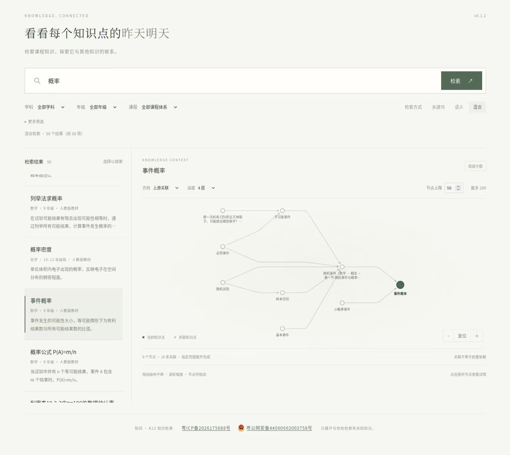
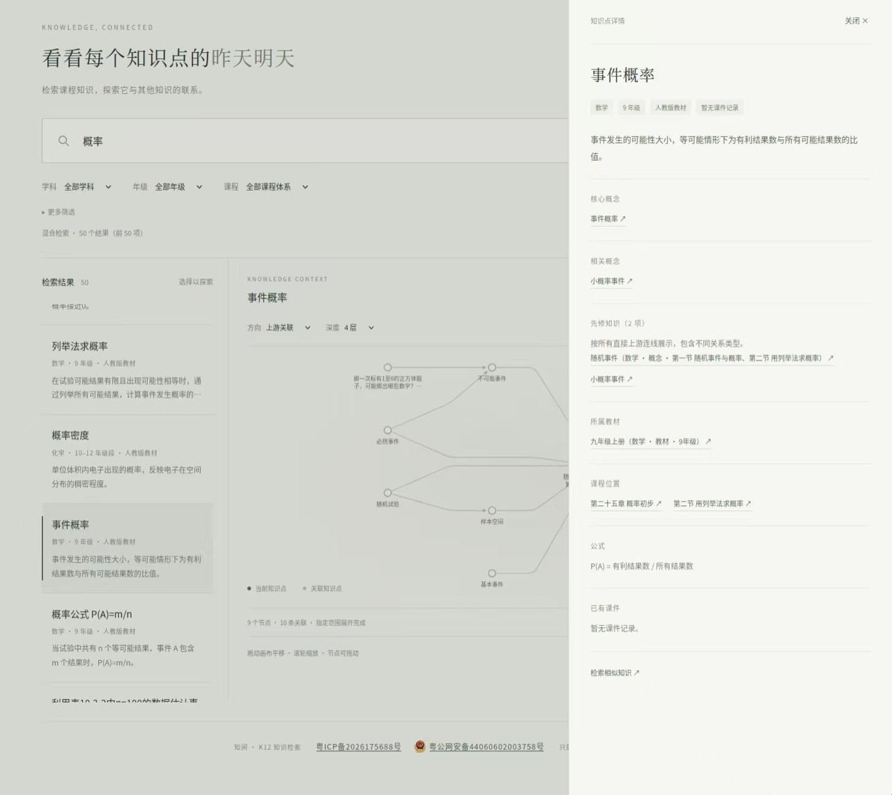

# Kid Courseware：K12 知识与学习诊断基础设施

## 基本信息

| 项目 | 内容 |
| --- | --- |
| 基础设施名称 | Kid Courseware / 知间 |
| 基础设施类型 | K12 知识组织、项目拆解与学习诊断服务 |
| 服务网站 | **<https://kidcourseware.cn>** |
| 访问与合规 | **已完成工信部 ICP 备案和公安联网备案，官方 HTTPS 网站可正常访问** |
| 源代码仓库 | `hata8210/kid-courseware`（私有仓库） |
| 当前状态 | 网站已提供知识检索与关系探索能力；MCP 和 Agent Skill 对外服务处于规划建设阶段 |
| 在本项目中的角色 | 为 Long-Tail Education 中的 AI 教学应用提供共享的知识与学习诊断底座 |

## 网站截图

### 首页与知识检索入口



### 知识检索结果与关系图



### 知识点详情与先修知识



## 一、定位

Kid Courseware 不只是一个知识点查询网站，也不以成为传统课件库为主要目标。它在 Long-Tail Education 中承担基础设施角色：为 AI 教学应用提供可查询、可解释、可验证的 K12 知识结构，帮助应用理解一个学习目标涉及什么知识、依赖哪些基础、学习者可能缺少什么，以及后续可以怎样组织学习与验证。

一句话定位：

> 为 AI 教学应用免费提供 K12 知识地图和学习诊断能力，支持 PBL、STEAM 及其他个性化学习场景中的知识拆解、先修分析和查漏补缺。

这项基础设施关注的不是替代教师作出最终教学判断，而是降低 AI 教学应用获得可靠教育知识结构的成本，让不同应用不必重复建设同一套底层能力。

## 二、服务对象

- 面向学习者的 AI 导师、学习伙伴和项目助手。
- 面向教师的备课、项目设计、学情诊断和教学支持工具。
- PBL、STEAM、创客教育和跨学科学习应用。
- 需要进行课程知识对齐、学习路径组织或能力诊断的教育产品。
- Long-Tail Education 中孵化的项目、实验、解决方案和软件原型。

## 三、核心基础能力

### 3.1 知识理解与定位

帮助 AI 应用识别学习者或项目中提到的知识、技能、实验和任务，理解它们的基本含义、所属学科、学习阶段以及与其他内容的关系。

### 3.2 项目与任务拆解

把“我想做什么”翻译成“完成它需要学习和运用什么”。对于一个 PBL 或 STEAM 项目，可拆解出：

- 涉及的学科与跨学科主题；
- 核心概念和支撑概念；
- 需要掌握的实践技能；
- 可开展的实验、练习和探究任务；
- 项目各阶段对应的知识需求；
- 最终成果应体现的学习目标。

### 3.3 先修关系分析

区分完成任务所需内容的不同角色：

- 必须提前掌握的基础；
- 可以在项目过程中按需学习的内容；
- 用于深化理解的拓展内容；
- 可能阻塞后续任务的关键缺口。

### 3.4 查漏补缺

将项目所需能力与学习者当前状态进行比较，输出结构化诊断。诊断应区分：

- 已掌握；
- 可能掌握但尚未验证；
- 明确缺失；
- 当前没有足够信息判断。

“缺少学习记录”不能直接等同于“学习者不会”。诊断结论应保留证据、不确定性和待验证项。

### 3.5 学习支持建议

根据不同类型的缺口，建议适合的支持方式，例如：

- 概念理解：解释、阅读、示例或微课；
- 技能形成：分步练习与即时反馈；
- 规律验证：观察、实验和数据分析；
- 迁移应用：真实问题或项目子任务；
- 掌握验证：诊断题、作品证据或表现性任务。

基础设施可以先说明“需要什么类型的支持”，不必包办所有教学内容的生产。

### 3.6 学习成果与评价对齐

将知识、技能、项目产出和评价证据连接起来，帮助 AI 应用回答：

- 这个任务希望学习者学会什么；
- 什么行为或作品可以证明已经掌握；
- 当前证据能够支持什么结论；
- 哪些目标还没有得到验证。

### 3.7 可解释与可追溯

重要结论应尽量说明：

- 为什么需要这个知识或技能；
- 它支持项目中的哪个任务；
- 它依赖哪些先修内容；
- 依据和来源是什么；
- 结论的置信程度如何；
- 是否存在其他合理的拆解或学习路线。

## 四、PBL / STEAM 支持流程

```text
项目目标或真实问题
        ↓
跨学科知识与技能拆解
        ↓
先修关系和关键依赖分析
        ↓
学习者当前状态核对
        ↓
知识与能力缺口诊断
        ↓
按需学习、练习、实验或探究
        ↓
通过任务产出和评价证据再次验证
        ↓
继续项目、调整路径或补充支持
```

这个过程应允许反复执行。随着学习者产生新的作品、回答和实验结果，AI 应用可以重新判断缺口，而不是一次性生成固定学习计划。

## 五、对外服务形态

### 5.1 网站

网站用于面向人展示和验证基础能力，让教师、学习者、研究者及产品人员可以直观地理解知识之间的联系。它也是基础设施的数据质量观察窗口，但不是全部能力的唯一入口。

### 5.2 MCP

计划通过 MCP 向外部 AI 应用提供可组合的原子能力。建议按教育任务表达工具，而不是直接暴露底层存储概念：

1. `Knowledge Lookup`：查找、识别和理解知识。
2. `Project Decompose`：把项目拆解为知识、技能、实验和任务。
3. `Gap Audit`：分析学习者缺少或尚未验证的先修能力。
4. `Learning Support`：组织有顺序的补充学习建议。
5. `Assessment Check`：判断现有任务和证据能否验证学习目标。

MCP 适合由 AI 应用在运行过程中按需调用，并获得结构化、可追溯的结果。

### 5.3 Agent Skill

计划提供可复用的 Agent Skill，将多个基础能力编排为完整教学流程，例如：

- PBL 项目知识拆解；
- STEAM 跨学科能力分析；
- 学习者先修知识诊断；
- 查漏补缺方案生成；
- 教学活动与评价证据检查；
- 项目执行过程中的阶段性复诊。

Agent Skill 负责工作流和教学语境，MCP 负责提供可调用的知识与诊断能力，两者互补而不相互替代。

## 六、免费公共服务原则

对外免费服务应建立在可持续、公平和隐私友好的边界上：

- 公共基础能力以只读查询和诊断为主；
- 正常教学、研究和原型应用可使用免费额度；
- 不要求上传学生真实姓名或其他不必要的身份信息；
- 学习状态尽量采用匿名、最小化的结构化数据；
- 不默认长期保存学习者的个人诊断记录；
- 批量或高频商业使用可申请更高额度或选择自行部署；
- 对知识缺失、冲突、低置信结论和服务限制进行明确提示；
- 知识数据和诊断规则应具有版本、来源与更新记录；
- 为教师和开发者提供纠错与反馈渠道。

免费不意味着无限制调用。合理额度和防滥用机制用于保障公共服务能够持续服务真实教学需求。

## 七、能力边界

这项基础设施：

- 不替代教师作出最终教学判断；
- 不把知识关系自动等同于唯一正确的教学顺序；
- 不根据缺少记录直接判定学习者不会；
- 不把一次诊断当作长期固定的学习者标签；
- 不以自动生成大量内容作为主要价值；
- 不承诺已经覆盖全部学科、课程体系和学习阶段；
- 不直接等同于完整的课程平台、学习管理系统或课件资源库。

## 八、与 Long-Tail Education 的关系

Long-Tail Education 收集传统课堂难以持续满足的个性化学习需求。Kid Courseware 为这些需求提供一项共享底座：

| Long-Tail Education 场景 | 基础设施提供的支持 |
| --- | --- |
| “我到底哪里不会？” | 先修分析、缺口诊断和待验证项 |
| 不同学习者需要不同路径 | 基于现有基础组织不同的补充顺序 |
| 从兴趣或项目出发学习 | 将项目目标映射到知识、技能和任务 |
| 跨学科学习 | 建立不同学科概念和通用技能之间的联系 |
| 即时问题与临时学习需求 | 快速定位相关知识及其上下游关系 |
| 教师难以持续一对一跟进 | 为 AI 应用提供可复用的诊断和解释能力 |
| 教学实验与效果观察 | 提供可重复执行的诊断结构和变化依据 |

网站负责展示，MCP 负责连接，Agent Skill 负责教学流程编排，知识与学习诊断能力负责提供共同基础。

## 九、建议建设方向

1. 建立稳定的公共能力契约和版本机制。
2. 优先补全跨学科、跨年级和同一概念的递进关系。
3. 建立项目目标到知识、技能、实验、任务和评价证据的映射。
4. 定义匿名学习者能力状态和诊断结果的数据表达。
5. 区分知识事实、关系推断和教学建议，并分别给出依据与置信度。
6. 发布首批 PBL / STEAM MCP 工具和 Agent Skill 示例。
7. 使用真实但匿名的教学案例开展小规模验证。
8. 建立错误反馈、数据修订和兼容性治理流程。

## 十、效果评价建议

基础设施是否有效，不应只看知识数量或调用次数，还可以观察：

- 项目拆解是否覆盖完成任务真正需要的知识与技能；
- 诊断是否能够发现关键缺口且减少误判；
- 建议是否能被教师理解、核对和调整；
- 学习者补充学习后能否完成原本受阻的任务；
- 相同输入在相同版本下是否能够得到稳定、可复核的结果；
- 外部 AI 应用接入后是否减少了重复建设成本；
- 免费服务是否真正支持了教学、研究和非商业创新。

最终目标不是让 AI 输出更多内容，而是让 AI 教学应用更准确地理解学习任务、识别差异，并在恰当的时候提供恰当的帮助。
